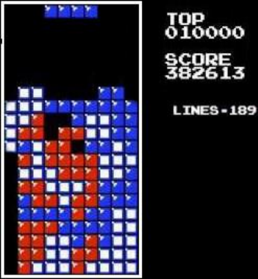

# Tetris

Tetris' gameplay consists of a rectangular field in which pieces called
_tetrominoes_, geometric shapes consisting of four connected squares, descend
from the top-center.

During the descent, the player can move the piece horizontally and rotate them
until they touch the bottom of the field or another piece. The player's goal is
to stack the pieces in the field to create horizontal lines of blocks.

When a line is completed, it disappears and the blocks placed above fall one
row. The game ends if the accumulated pieces in the field block other pieces
from entering the field, a process known as "topping out".

Common mechanics among Tetris versions include soft drop (increasing the
descent of the piece) and hard drop (instantly placing the piece as far down as
it can go).

The objective of Tetris is to collect as many points as possible during a
gameplay session by clearing lines. The more lines cleared at once, the higher
the score for a line clear. Clearing four lines at once using an I- shaped
tetromino is referred to as a "Tetris".

