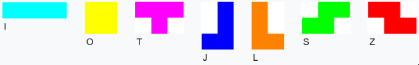

# Specifications

## GUI

The display of the LandTiger should show:

- On the left:
  - [x] the playing field.

- On the right:
  - [x] current score;
  - [x] high score;
  - [x] cleared line count.

## Game mechanics

- **Playing field**:
  - [x] Should be a grid of 20 x 10 squares.

- **Starting and pausing the game**:
  - Initially:
    - [x] the game is in the "paused" state;
    - [x] the grid is empty;
    - [x] `high_score = 0`;
    - [x] `cleared_lines = 0`;
    - [x] pressing KEY1 (_after reset_) starts the game;
  - [x] pressing KEY1 _during the game_ toggles between the "paused" and "playing" states.

- **Tetrominoes**:
  - [x] tetrominoes are composed of 4 blocks arranged in various shapes.
  - [x] each block occupies the space of a square in the playing field grid.
  - [x] each tetromino must be implemented as a global variable.
  

    
  

- **Tetromino Generation**:
  - [x] at the beginning of the game, a random tetromino appears on the top of the playing field;
  - [x] when a tetromino is placed on the playing field, a new random tetromino is generated in the same way.

- **Tetromino Movement**:
  - [x] `CURR_TETROMINO_SPEED = 1 square/second` towards the bottom of the screen (no user interaction)
  - [x] joystick left or right: the piece is moved in the specified direction.
  - [x] joystick up: the tetromino is rotated 90° clockwise.
  - [ ] joystick down: `CURR_TETROMINO_SPEED = 2 square/second` (**soft drop**)
  - [x] `KEY2`: the tetromino falls instantly (**hard drop**).
  - [x] once the tetromino reaches a solid surface (bottom of the playing field or the top of another block), `placed = true && CURR_TETROMINO_SPEED = 0`.

- **Clearing lines**:
  - [ ] the check occurs each time a tetromino is placed on the field.
  - [ ] if (one or more horizontal lines of 10 squares have been completely filled with blocks)
    - [ ] the blocks in those lines are eliminated;
    - [ ] the blocks in the lines above are shifted down;
    - [ ] when 4 lines are cleared, the move is called a "tetris"

- **Scoring**:
  - [ ] Placing a tetromino in the field awards 10 points.
  - [ ] Clearing a single line awards 100 points plus the 10 points from the tetromino placement.
  - [ ] Clearing multiple lines awards 100 points x number of cleared lines plus the 10 points from the tetromino placement.
  - [ ] A tetris awards 600 points plus the 10 points from the tetromino placement.

- **Lose conditions**:
  - [?] The game finishes when the placed tetromino goes over the top of the playing field. (considering how things are currently implemented, this event never occurs.)
  - [x] If the generated tetromino that appears at the top of the field overlaps with another block, the game ends as well.

- **Game end**:
  - [x] if (`curr_score` > `high_score`) `high_score := curr_score`
